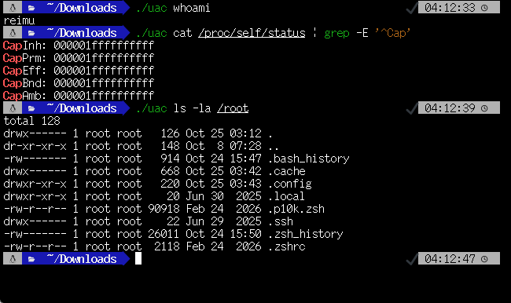

# LinUAC
This project aims to implement a feature on Linux that allows the user to gain administrator privileges while remaining the current user, similar to Windows User Account Control (UAC).

## How to use
1. Build this with `cargo build --release`.
   - libcap is required.
2. Change the owner of the executable file with `chown root:root uac`.
3. Add the `setuid` attribute with `chmod 4755 uac`.
4. It is used like this: `uac ls -la /root`.

## Caution
This project is in the experimental stage and is not yet practical.
